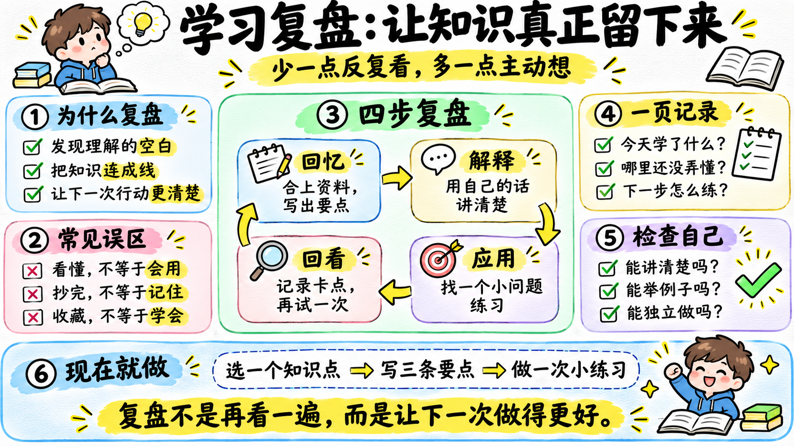

# ✏️ Sketchnote Infographic · 手绘知识海报

把文章、笔记或主题，变成白底、粗黑手写标题、马卡龙分区、荧光笔重点和少量 Q 版插画的中文知识海报。

这是一个独立的 Agent Skill 仓库，支持通过 npm / npx 安装到 Codex、Claude Code 等客户端。图片由客户端实际提供的图片生成工具完成；没有出图工具时，skill 会交付完整提示词并说明限制。



## 安装

需要 Node.js ≥22.20、npm 和 Git。下面两种方式都使用 [Vercel Skills CLI](https://github.com/vercel-labs/skills) 从本仓库安装 skill，任选一种即可。

### npx 一次性安装（推荐）

在要使用 skill 的项目目录中运行，不必提前全局安装命令行工具：

```bash
npx --yes skills@1.8.1 add u7-u7/sketchnote-infographic --skill sketchnote-infographic --agent codex claude-code --yes
```

只用 Codex 时，将 `--agent codex claude-code` 改成 `--agent codex`；只用 Claude Code 时改成 `--agent claude-code`。想安装到所有项目都能使用的用户目录，在命令末尾加 `--global`：

```bash
npx --yes skills@1.8.1 add u7-u7/sketchnote-infographic --skill sketchnote-infographic --agent codex claude-code --global --yes
```

### npm 安装命令行工具后添加 skill

```bash
npm install --global skills@1.8.1
skills add u7-u7/sketchnote-infographic --skill sketchnote-infographic --agent codex claude-code --yes
```

第一条命令全局安装 `skills` 工具，第二条将本 skill 安装到当前项目。要全局安装 skill，同样在第二条命令末尾加 `--global`。

项目级安装会创建 `.agents/skills/sketchnote-infographic`、所选客户端需要的链接，以及 `skills-lock.json`。安装后在客户端的新对话中使用；如果当前客户端没有刷新技能列表，重新打开客户端。

## 使用

Codex：

```text
$sketchnote-infographic 把这篇文章做成中文手绘知识海报，保留关键结论。
```

Claude Code：

```text
/sketchnote-infographic 参考这张图的风格，画一张讲清“学习复盘”的知识图。
```

也可以要求手机竖版或仅生成提示词：

```text
把这份操作流程做成适合手机阅读的竖版手账信息图。
只给我可以直接用于图片生成工具的完整提示词，主题是时间管理。
```

默认横版 16:9，先整理上图文案，再绘制分区与流程，出图后检查中文、编号和箭头。参考图只提供风格；长资料会先精简重复信息，必要时分页。

## 检查、更新和卸载

```bash
# 查看仓库可安装的技能，不安装
npx --yes skills@1.8.1 add u7-u7/sketchnote-infographic --list

# 查看当前项目已安装的技能
npx --yes skills@1.8.1 list

# 检查已安装技能的更新
npx --yes skills@1.8.1 check

# 更新已安装的技能
npx --yes skills@1.8.1 update

# 从当前项目移除本 skill
npx --yes skills@1.8.1 remove sketchnote-infographic --agent codex claude-code --yes
```

全局安装的技能，查看或移除时加 `--global`。`update` 会检查并更新安装器管理的技能，执行前按输出核对范围。

## 文件

- [SKILL.md](skills/sketchnote-infographic/SKILL.md)：风格规则、内容整理、出图和检查流程。
- [提示词模板与完整示例](skills/sketchnote-infographic/references/prompt-template.md)：可替换主题的出图模板，以及上面示例图的实际提示词。
- [Codex 展示信息](skills/sketchnote-infographic/agents/openai.yaml)。

本 skill 不绑定专用 API，不自带图片生成模型。安装 skill 不会替客户端增加其本来没有的出图能力。
